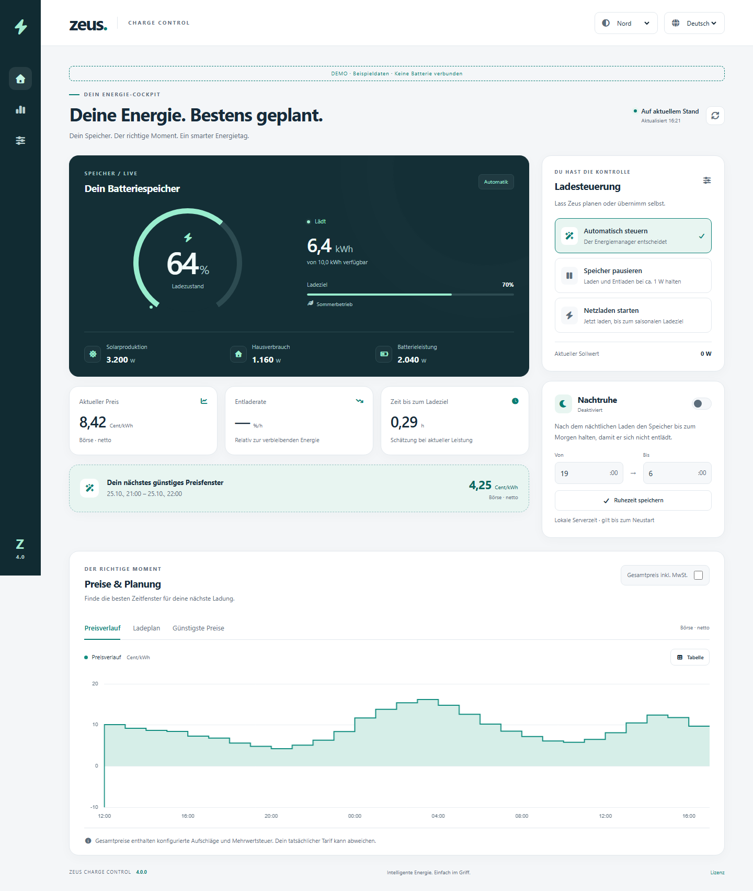
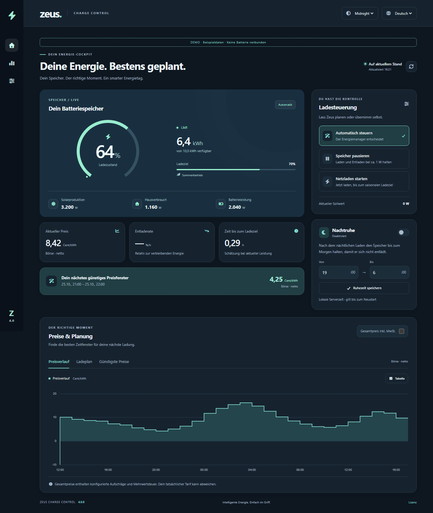

# Dashboard screenshots — 4.0.0

Generated locally with Playwright against real Spring/Thymeleaf pages and simulated battery services. Every capture includes a visible **DEMO / sample data** label. No real battery data or credentials are shown.

| Theme | Desktop · 1440 CSS px | Mobile · 390 CSS px |
| --- | --- | --- |
| Nord | [Open](../images/screenshots/dashboard-nord-desktop.png) | [Open](../images/screenshots/dashboard-nord-mobile.png) |
| Midnight | [Open](../images/screenshots/dashboard-midnight-desktop.png) | [Open](../images/screenshots/dashboard-midnight-mobile.png) |
| Forest | [Open](../images/screenshots/dashboard-forest-desktop.png) | [Open](../images/screenshots/dashboard-forest-mobile.png) |
| Solar | [Open](../images/screenshots/dashboard-solar-desktop.png) | [Open](../images/screenshots/dashboard-solar-mobile.png) |
| Ember | [Open](../images/screenshots/dashboard-ember-desktop.png) | [Open](../images/screenshots/dashboard-ember-mobile.png) |

Mobile captures use Chromium with the iPhone 13 device viewport and device scale factor. They are device emulation, not a test on physical iOS hardware or Safari.





## Regenerate

With Java 21 selected and Maven/Node installed:

```bash
npm ci --ignore-scripts
npx playwright install chromium
npm run screenshots
```

The script prepares test classes, starts an isolated server at `127.0.0.1:18080`, captures all five themes at both sizes and stops its server. Dates follow the fixture's current time, so screenshots are reproducible through the same workflow rather than byte-identical across different days. Automated functional assertions and axe checks are the regression gates; these full-page captures are review artifacts, not pixel-baseline assertions.
